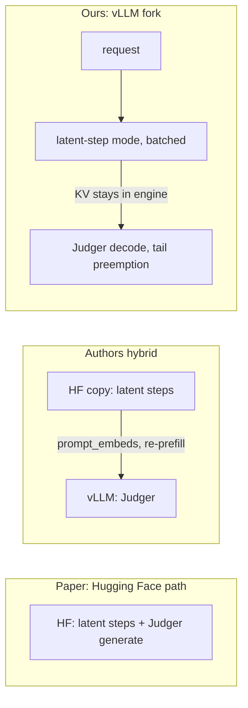

# Unified LatentMAS inference in a vLLM fork

Our contribution: a vLLM fork that runs **all** of LatentMAS (latent steps and Judger decode) inside one engine. It is built regardless of what profiling shows. We then compare it against the paper's Hugging Face path.

## Context
- The paper's published numbers use the Hugging Face path. Its "vLLM support" relies on an unreleased patch plus a second Hugging Face model doing the latent steps, with a blocking handoff via `prompt_embeds` and a re-prefill.
- Latent rollout today: `generate_latent_batch_hidden_state` in [models.py](models.py). Judger handoff: `run_batch_vllm` in [methods/latent_mas.py](methods/latent_mas.py).
- Existing serving pieces to reuse: [serving/tail_preempt_scheduler.py](serving/tail_preempt_scheduler.py) (vLLM 0.11.1), [scripts/serve_scale.py](scripts/serve_scale.py) (closed-loop concurrency harness), [serving/embed_assembly.py](serving/embed_assembly.py) (repaired hybrid assembly for the hybrid baseline).

## Step 1: Fork setup
- Fork vLLM at the 0.11.1 tag, pin the commit, editable install on the pod.
- Smoke test: stock Qwen3-14B generation and `TailPreemptScheduler` via `scheduler_cls` still work on the fork.

## Step 2: Latent-step mode in the V1 model runner
- Per-request flag plus remaining latent-step count. While a request has latent steps left, the runner skips sampling and writes `realign(last_hidden)` into the `inputs_embeds` buffer for that request's next position.
- Return last-layer hidden states from Qwen3 for flagged requests. Port the realignment matrix and norm rescaling from `_apply_latent_realignment` in `models.py`.
- Latent positions occupy normal KV blocks, so the scheduler, preemption, and the tail scheduler treat them like any other tokens. Recompute after preemption has to replay stored latent embeddings rather than token IDs.
- Agent transitions: when an agent's latent steps finish, the next agent's role prompt is appended as ordinary tokens to the same request.

## Step 3: Correctness against Hugging Face
- On 5 GSM8K items, per-step latent vectors match `generate_latent_batch_hidden_state` within bf16 tolerance.
- Greedy Judger text matches the HF path (and the repaired hybrid) on those items.

## Step 4: Unified pipeline
- New [methods/latent_mas_vllm.py](methods/latent_mas_vllm.py), wired into [run.py](run.py) as a new method flag. No HF model loaded.
- Supports sequential and hierarchical prompts, like `methods/latent_mas.py`.
- Stock and tail scheduler arms via `scheduler_cls`.

## Step 5: Comparison
- Tasks: AIME 2024+2025 (60), MATH (n=200), GSM8K (n=200). Qwen3-14B, one H200. Greedy and Qwen thinking sampling reported separately.
- Primary comparison: the unified vLLM fork vs the HF-only LatentMAS path (the paper's setup).
- Additional arms: authors' hybrid (repaired assembly), single model on vLLM, text multi-agent on vLLM.
- Concurrency 1/8/16/32/60 with closed-loop submission (extend `scripts/serve_scale.py` to run full requests end to end, not cached Judger embeddings).
- Metrics: throughput (requests/s, output tokens/s), p50/p95 end-to-end latency, accuracy with paired bootstrap CIs, GPU memory split, preemptions and recomputed tokens.

## Step 6: Write-up
- Slides in the style of `docs/slides_tail_preempt_oct22.tex` and a results doc in `docs/`.
- Related work: LatentMAS and its serving path, CacheBack, Coconut, KV-transfer systems (CacheGen, LMCache, disaggregated prefill), preemption and recompute scheduling.

## Risks
- Per-step hidden-state feedback touches V1 runner internals (input batch buffers, CUDA graphs, async scheduling). Start with CUDA graphs and async scheduling disabled for latent requests, then re-enable.
- Recompute after preemption must reproduce latent positions from stored embeddings. Getting this wrong silently corrupts outputs, so Step 3 tests also run under forced preemption.
